<p align="center">
  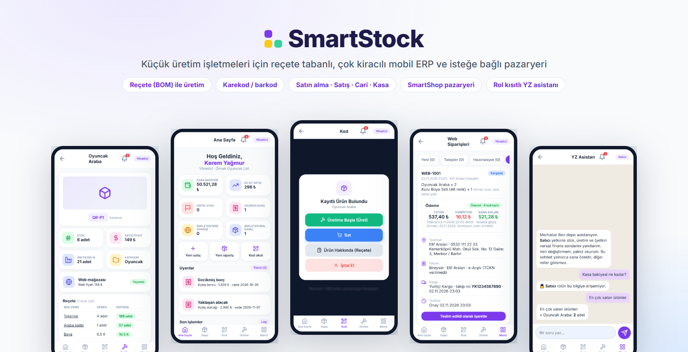
</p>

<h1 align="center">SmartStock</h1>

<p align="center">
  <b>Küçük üretim işletmeleri için reçete tabanlı üretim, stok ve pazaryeri süreçlerini bütünleştiren çok kiracılı mobil ERP</b>
</p>

<p align="center">
  
  
  
  
  
  
  
</p>

> [!NOTE]
> Bu bir **vitrin reposudur**. Projenin amacını, mimarisini, iş kurallarını ve ön çalışma ekranlarını tanıtır; **kaynak kod paylaşılmamaktadır**. Ekran görüntüleri, ön çalışmada geliştirilen çalışan simülasyonlardan alınmıştır. Ekranlardaki şirket, kişi ve tutarlar örnek verilerdir.

---

## İçindekiler

- [Neden SmartStock?](#neden-smartstock)
- [Öne çıkan özellikler](#öne-çıkan-özellikler)
- [Ekranlar](#ekranlar)
- [Mimari](#mimari)
- [Roller ve yetkiler](#roller-ve-yetkiler)
- [Araştırma soruları ve hipotezler](#araştırma-soruları-ve-hipotezler)
- [Yol haritası](#yol-haritası)
- [Proje bilgileri](#proje-bilgileri)
- [Ayrıntılı dokümanlar](#ayrıntılı-dokümanlar)
- [English summary](#english-summary)

---

## Neden SmartStock?

KOBİ'ler Türkiye'deki girişimlerin **%99,6**'sını, çalışanların **%68,5**'ini ve katma değerin **%41,2**'sini oluşturur (KOSGEB, 2026). Buna karşın dijital teknolojileri benimsemede büyük işletmelerin gerisinde kalırlar; küçük işletmelerin ERP kullanma olasılığı özellikle düşüktür (Kergroach, 2021).

Küçük üretim atölyelerinde hammadde alımı, reçeteye göre üretim, satış, cari hesap ve kasa kayıtları çoğunlukla kâğıtta, elektronik tablolarda ya da birbirinden kopuk uygulamalarda tutulur. Sonuç: fiziksel stoktan sapan kayıtlar ve finansal takip hataları. Bir perakende zincirinde incelenen yaklaşık 370.000 stok kaydının **%65**'inin hatalı olduğu bulunmuştur (DeHoratius ve Raman, 2008).

**SmartStock**, bu süreçleri akıllı telefondan kullanılabilen, yüksek lisans maliyeti gerektirmeyen **tek bir tutarlı işlem zincirinde** birleştirir:

```
Tedarikçi → Satın alma → Mal kabul → Reçeteyle üretim → Satış / Web siparişi → Tahsilat · Ödeme → İşlem kaydı
```

## Öne çıkan özellikler

| | Özellik | Ne sağlar? |
|---|---|---|
| 🧾 | **Reçete (BOM) tabanlı üretim** | Her ürün, malzeme ve miktarlardan oluşan bir reçeteyle tanımlanır. Üretilebilir azami miktar anlık hesaplanır; üretim tek bir veritabanı işleminde malzemeyi düşer, ürünü artırır. |
| 🔒 | **Değişmez kayıt, atomik iş kuralları** | Stok formdan elle değiştirilemez; yalnızca mal kabul, üretim, satış, ters kayıtla iptal ve gerekçeli sayım düzeltmesiyle değişir. Hiçbir hareket silinmez. |
| 🏢 | **Veritabanı düzeyinde kiracı yalıtımı** | Tüm şirketler aynı veritabanını paylaşır; her iş tablosunda `company_id` ve PostgreSQL **satır düzeyi güvenlik (RLS)** politikaları bulunur. |
| 👥 | **Rol tabanlı erişim (RBAC)** | Yönetici, Satıcı ve Depo/Üretim rolleri. Yetki arayüzde, ekranda ve sunucuda olmak üzere **üç katmanda** uygulanır. |
| 📷 | **Karekod / barkodla hızlı iş akışı** | Etiketler uygulamadan üretilip yazdırılır. Okutulan koda ve kullanıcının rolüne göre ilgili işlem (üret, sat, mal kabul, reçete, yeni kayıt) doğrudan açılır. |
| 🛒 | **İsteğe bağlı çok satıcılı pazaryeri (SmartShop)** | Web stoğu depo stoğuyla ortaktır. Sipariş verilince stok ayrılır, satıcı parçalarına bölünür; kart bilgisi sisteme hiç girmez. |
| 🤖 | **Rol kısıtlı, salt okunur YZ asistanı** | Doğal dilde stok, üretilebilir miktar, açık alacak/borç ve satış özeti sorulabilir. Asistan yalnızca kullanıcının rolüne göre süzülmüş veriyi görür ve veri yazamaz. |

<details>
<summary><b>Reçete tabanlı üretim: azami üretim hesabı</b></summary>

<br>

Bir ürün için *i*. malzemenin stoğu $S_i$, bir ürün için gereken miktarı $r_i$ ise:

$$
Q_{\max} = \min_{i = 1, \dots, n} \left\lfloor \frac{S_i}{r_i} \right\rfloor
$$

**Örnek: Oyuncak Araba** (ekran görüntüsündeki değerler)

| Malzeme | Bir ürün için | Depoda | $\lfloor S_i / r_i \rfloor$ |
|---|---|---|---|
| Tekerlek | 4 adet | 188 adet | 47 |
| Araba kalıbı | 1 adet | 57 adet | 57 |
| Boya | 0,5 lt | 10,5 lt | **21** |

→ Üretilebilir azami miktar **21 adet**; darboğaz boyadır. Malzeme yetmezse üretim yapılmaz ve en fazla üretilebilecek adet gösterilir.

</details>

## Ekranlar

### Mobil uygulama

<table>
  <tr>
    <td align="center">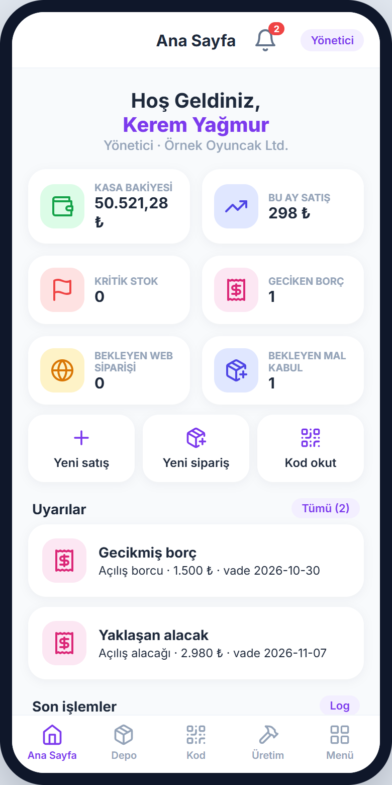<br><sub>Ana sayfa ve uyarılar</sub></td>
    <td align="center">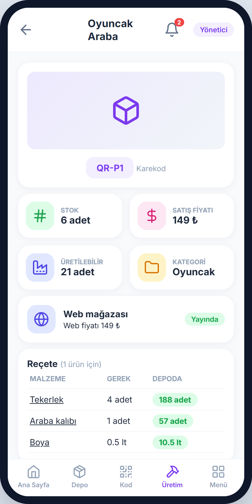<br><sub>Ürün kartı, reçete ve üretilebilir miktar</sub></td>
    <td align="center">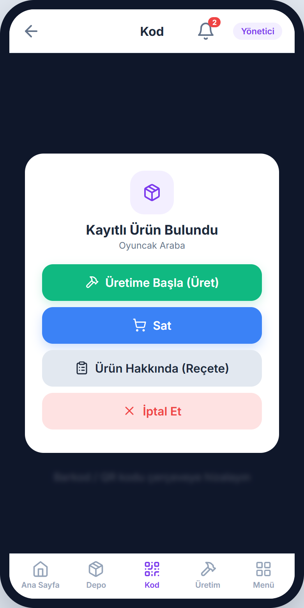<br><sub>Kod okutunca rol bazlı işlem penceresi</sub></td>
    <td align="center">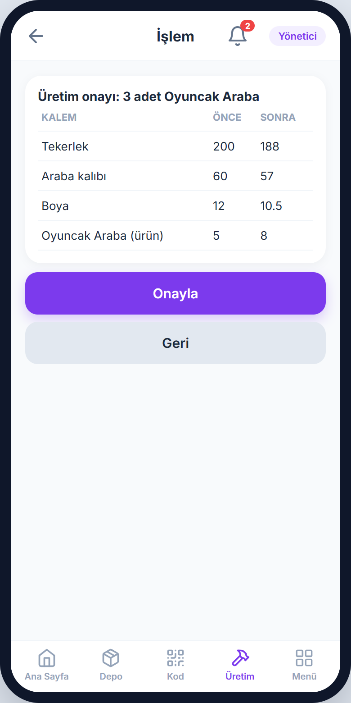<br><sub>Üretim onayı: önce / sonra stok</sub></td>
  </tr>
  <tr>
    <td align="center">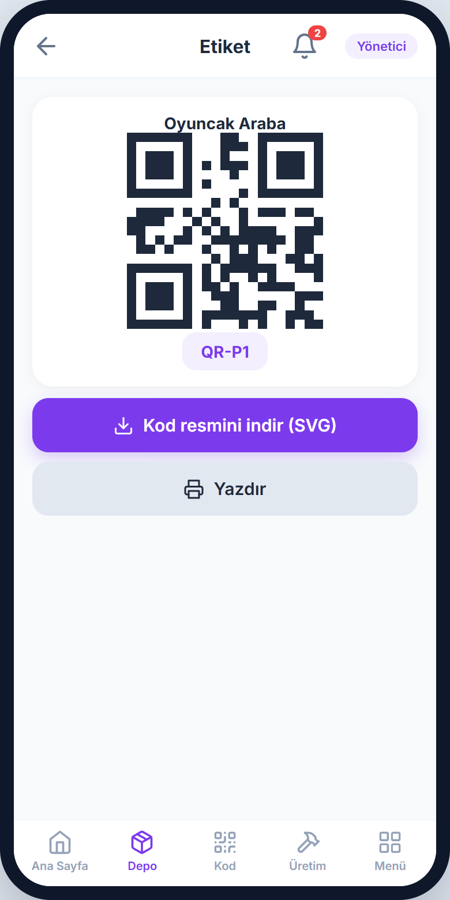<br><sub>Karekod etiketi üretimi</sub></td>
    <td align="center">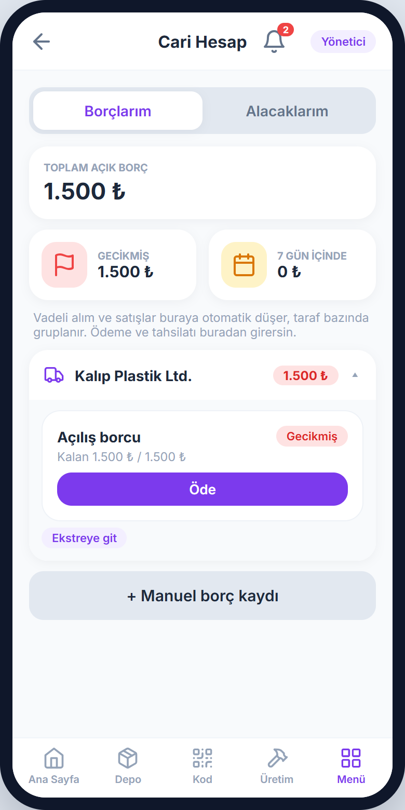<br><sub>Vade sıralı cari hesap</sub></td>
    <td align="center">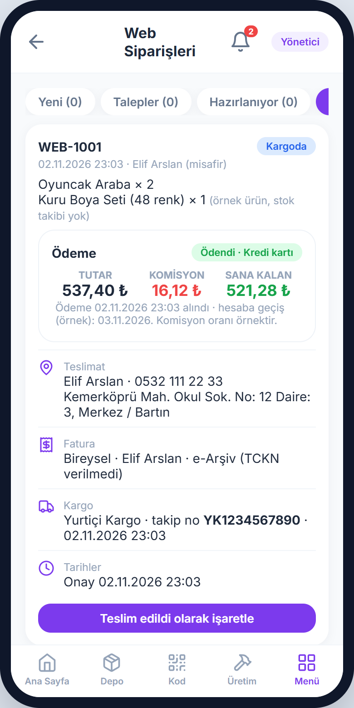<br><sub>Web siparişi: komisyon ve satıcıya kalan</sub></td>
    <td align="center">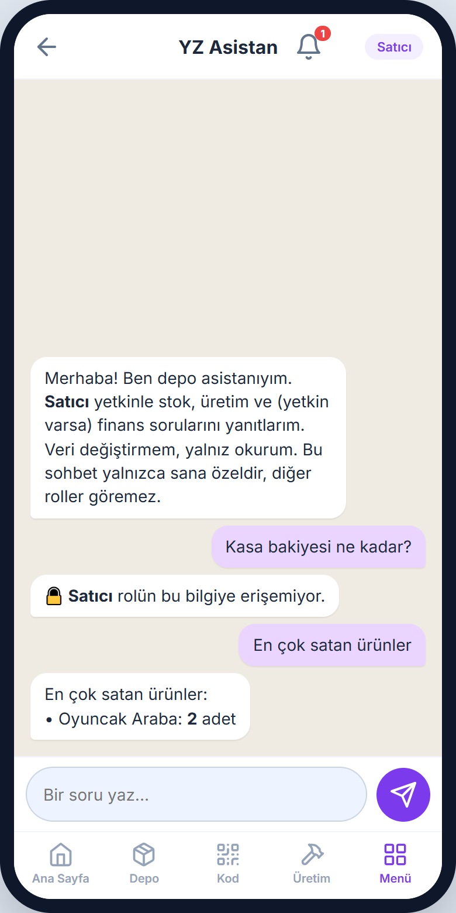<br><sub>YZ asistanı rol dışı soruyu reddeder</sub></td>
  </tr>
</table>

### SmartShop pazaryeri

<table>
  <tr>
    <td align="center" width="50%">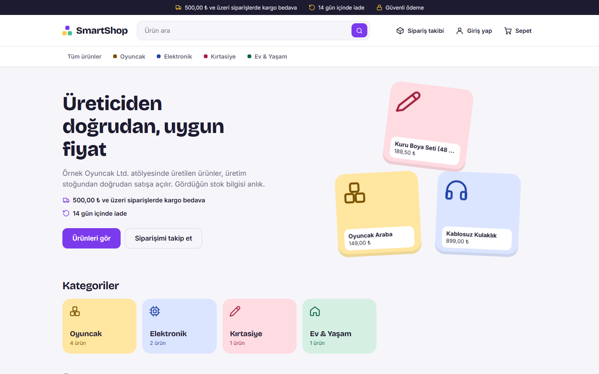<br><sub>Vitrin</sub></td>
    <td align="center" width="50%">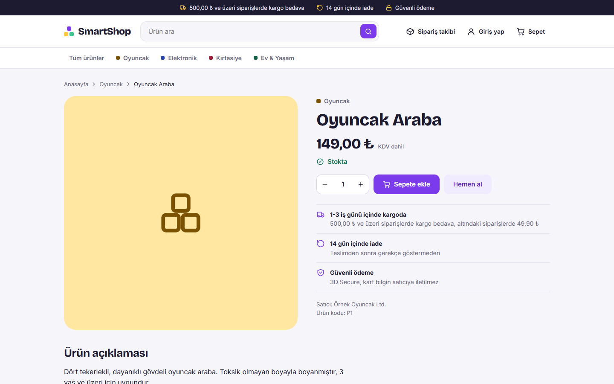<br><sub>Ürün sayfası: stok bilgisi depoyla ortak</sub></td>
  </tr>
  <tr>
    <td align="center">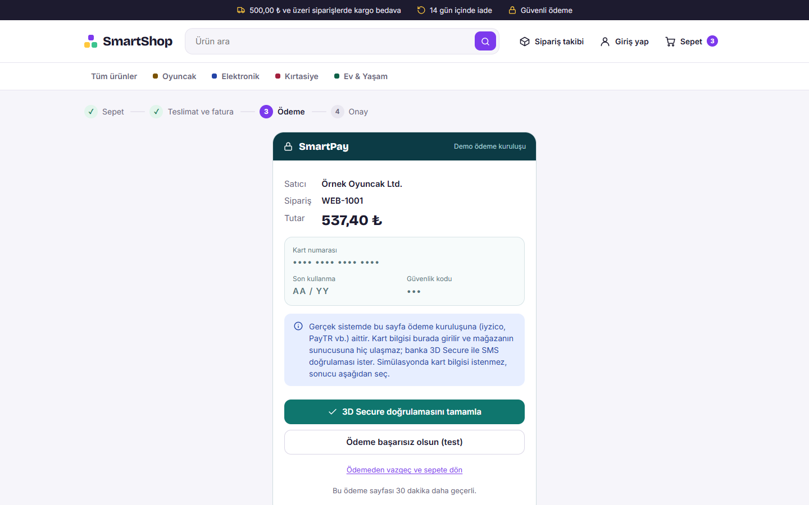<br><sub>Kart ödemesi ödeme kuruluşunun sayfasında</sub></td>
    <td align="center">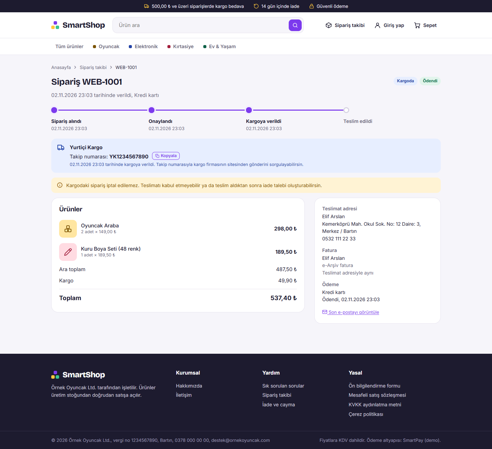<br><sub>Müşterinin sipariş ve kargo takibi</sub></td>
  </tr>
</table>

➡️ Tüm ekranlar ve açıklamaları: **[docs/ekran-goruntuleri.md](docs/ekran-goruntuleri.md)**

## Mimari

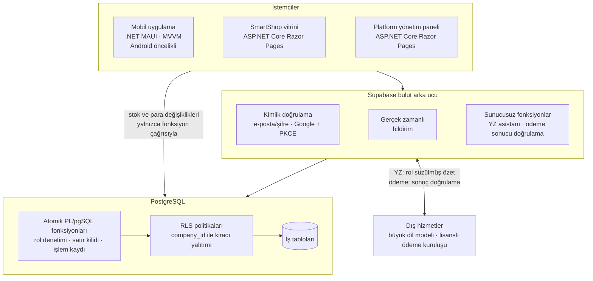

<sub>İki .NET istemcisi modelleri, doğrulayıcıları ve rol matrisini ortak bir sınıf kitaplığında paylaşır.</sub>

- **İstemci tabloya doğrudan yazmaz.** Stok, cari ve kasayı değiştiren her işlem; üyelik ve rol denetimi yapan, ilgili satırları `SELECT … FOR UPDATE` ile kilitleyen ve işlemi işlem kaydına yazan **tek bir sunucu fonksiyonu** çağrısıyla yapılır.
- **Hatalar ters kayıtla düzeltilir**, belge numaraları şirket başına sayaçlardan üretilir; para değerleri `numeric`, zaman damgaları UTC tutulur.
- **Çevrim dışı öncelikli yerel veritabanı** ön çalışmada değerlendirildi ancak çok kullanıcılı eşzamanlı kullanımda stok ve kasa tutarlılığı cihazlar arasında güvence altına alınamadığı için tutarlılığın sunucuda sağlandığı çok kiracılı bulut mimarisi seçildi.

➡️ Ayrıntılar: **[docs/mimari.md](docs/mimari.md)** · İş akışları ve sipariş durum makinesi: **[docs/is-akislari.md](docs/is-akislari.md)**

## Roller ve yetkiler

Yetkilendirme üç katmanda uygulanır: **(1)** menüde karo gizleme, **(2)** ekranda düğme gizleme, **(3)** sunucuda RLS politikaları ve fonksiyon içi rol denetimi. İlk iki katman yalnızca kullanım kolaylığı sağlar; asıl güvence üçüncü katmandır.

| Modül | Yönetici | Satıcı | Depo/Üretim |
|---|---|---|---|
| Depo (malzeme) | Tam yetki | Yalnızca görüntüler | Tam yetki *(alış fiyatını görmez)* |
| Üretim (ürün, reçete) | Tam yetki; maliyet ve kâr/marj görür | Yalnızca görüntüler | Görüntüler ve üretim yapar |
| Tedarikçi | Tam yetki (IBAN dahil) | Erişim yok | Yalnızca görüntüler *(borç ve IBAN gizli)* |
| Satın alma ve mal kabul | Tam yetki (iptal dahil) | Erişim yok | Sipariş ve kısmi mal kabul |
| Müşteri ve satış | Tam yetki (fiyat değiştirir, iptal eder) | Satış yapar *(fiyat salt okunur)* | Erişim yok |
| Cari hesap | Tam yetki (ödeme/tahsilat, manuel kayıt) | Yalnızca alacakları görür | Erişim yok |
| Kasa, kullanıcılar, CSV, sıfırlama | Yalnızca Yönetici | Erişim yok | Erişim yok |
| Web Satış ve Web Siparişleri | Yalnızca Yönetici *(mağazası olan şirkette)* | Erişim yok | Erişim yok |
| İşlem kaydı | Tüm kayıtlar | Yalnızca kendi işlemleri | Yalnızca kendi işlemleri |
| YZ asistanı (salt okunur) | Tüm operasyonel ve finansal veri | Satış ve alacak tarafı | Stok ve üretim tarafı |

<table>
  <tr>
    <td align="center">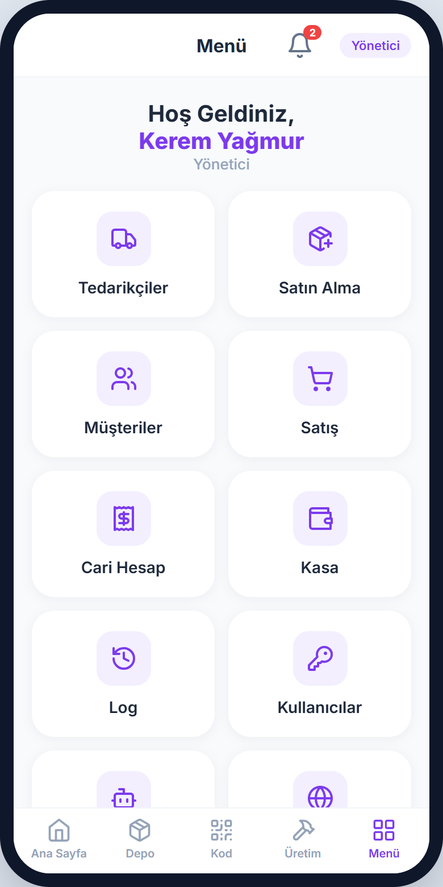<br><sub><b>Yönetici</b> menüsü</sub></td>
    <td align="center">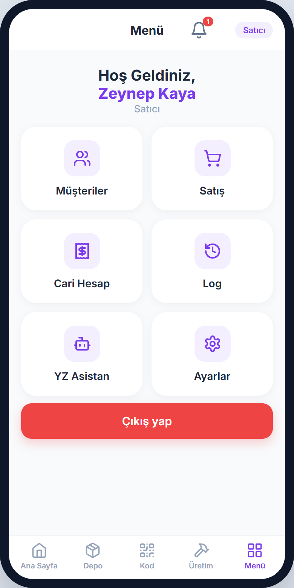<br><sub><b>Satıcı</b> menüsü</sub></td>
    <td align="center">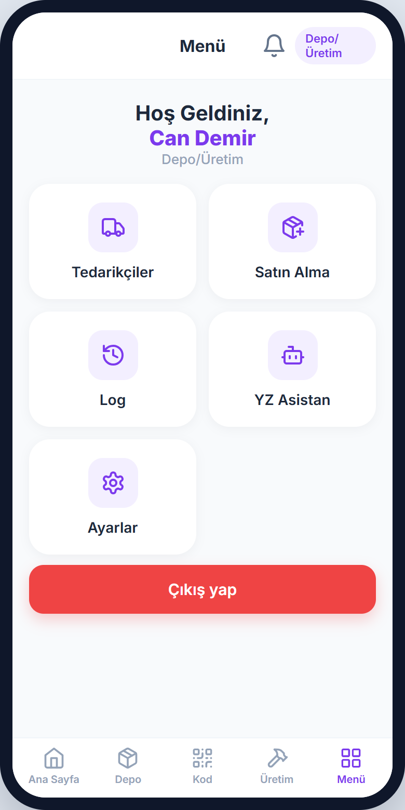<br><sub><b>Depo/Üretim</b> menüsü</sub></td>
  </tr>
</table>

Ayrı bir **platform yöneticisi** rolü satıcı başvurularını onaylar, kategori komisyonlarını yönetir ve hakedişleri izler. Bir kullanıcı birden fazla şirkete üye olabilir ve uygulamada etkin şirketi seçer.

➡️ Ayrıntılar: **[docs/guvenlik-ve-roller.md](docs/guvenlik-ve-roller.md)**

## Araştırma soruları ve hipotezler

Proje, bilgi sistemlerinde yaygın kullanılan **tasarım bilimi araştırması** yaklaşımıyla (Hevner vd., 2004; Peffers vd., 2007) yürütülür. Önerilen mimari, güvenceleri kapatılmış karşılaştırma sürümlerine ve manuel veri girişine karşı ölçülebilir hipotezlerle sınanır:

| | Hipotez | Başarı ölçütü |
|---|---|---|
| **H1** | Veri tutarlılığı | Aynı eşzamanlı işlem senaryosunda stok, cari ve kasa arasındaki mutabakat farkı **0**; stok ve kasa eksiye düşmez. |
| **H2** | İşlem süresi | Kamerayla kod okutma, listeden manuel seçime göre ortalama görev süresini **en az %30** kısaltır (α = 0,05). |
| **H3** | Erişim güvenliği | Arayüz atlanıp doğrudan API'ye gönderilen tanımlı yetkisiz erişim senaryolarının **%100**'ü engellenir. |
| **H4** | Kullanılabilirlik | Ortalama Sistem Kullanılabilirlik Ölçeği (SUS) puanı **≥ 70**. |

Ek hedefler arasında 20 eşzamanlı alıcıyla stoktan fazla satışın 0 olması, YZ asistanında rol dışı veri sızıntısının 0 ve doğru yanıt oranının en az %90 olması, sunucu fonksiyonlarının 20 eşzamanlı istemci altında 95. yüzdelik yanıt süresinin 500 ms'nin altında kalması yer alır.

➡️ Yöntem, değişkenler ve istatistiksel değerlendirme: **[docs/arastirma.md](docs/arastirma.md)**

## Yol haritası

| İş paketi | Proje öncesi | Ay 1–2 | Ay 3–4 | Ay 5–6 | Ay 7–9 | Ay 10 | Ay 11–12 |
|---|:-:|:-:|:-:|:-:|:-:|:-:|:-:|
| **Ön çalışma:** mobil uygulama ve pazaryeri simülasyonları | ✅ | | | | | | |
| **İP-1** Çok kiracılı veri modeli, kimlik doğrulama, yetki altyapısı | | 🟪 | | | | | |
| **İP-2** Stok ve üretim çekirdeği, karekod/barkod | | | 🟪 | | | | |
| **İP-3** Satın alma, satış, cari ve kasa | | | | 🟪 | | | |
| **İP-4** Çok satıcılı pazaryeri (SmartShop) | | | | | 🟪 | | |
| **İP-5** Rol kısıtlı, salt okunur YZ asistanı | | | | | | 🟪 | |
| **İP-6** Bütünleşik doğrulama, deneyler ve pilot kullanım | | | | | | | 🟪 |

<sub>✅ Tamamlandı (proje öncesi) · 🟪 Planlanan</sub>

➡️ Başarı ölçütleri, riskler ve B planları: **[docs/yol-haritasi.md](docs/yol-haritasi.md)**

## Teknoloji yığını

| Katman | Teknoloji |
|---|---|
| Mobil uygulama | .NET MAUI (C#, XAML), MVVM deseni, Android öncelikli (iOS ikincil hedef) |
| Web pazaryeri ve platform paneli | ASP.NET Core Razor Pages |
| Ortak kod | Paylaşılan sınıf kitaplığı: modeller, doğrulayıcılar, rol matrisi |
| Arka uç | Supabase: PostgreSQL, kimlik doğrulama, gerçek zamanlı bildirim, dosya depolama, sunucusuz fonksiyonlar |
| Veri güvenliği | PostgreSQL satır düzeyi güvenlik (RLS), PL/pgSQL atomik fonksiyonlar, sürümlenen geçiş (migration) dosyaları |
| Kimlik doğrulama | E-posta/şifre, Google hesabı; OAuth 2.0 + PKCE (RFC 7636), harici tarayıcı (RFC 8252), derin bağlantı |
| Test | pgTAP (veritabanı birim testleri), xUnit (paylaşılan iş kuralları) |
| Ödeme | PCI DSS uyumlu lisanslı ödeme kuruluşu (önce demo sağlayıcı, ardından test ortamı) |

## Kapsam dışı

Gerçek banka ve kargo entegrasyonu, e-Fatura/e-Arşiv, KDV hesaplaması, çoklu para birimi (yalnızca TL), çoklu depo, çevrim dışı eşzamanlama, uygulama mağazalarında yayın ve satıcı belgelerinin otomatik doğrulanması bu projenin kapsamı dışındadır.

## Proje bilgileri

| | |
|---|---|
| **Proje yürütücüsü** | Kerem Yağmur |
| **Danışman** | Dr. Öğr. Üyesi Bayram Akgül |
| **Kurum** | Bartın Üniversitesi · Mühendislik, Mimarlık ve Tasarım Fakültesi · Bilgisayar Mühendisliği Bölümü |
| **Program** | TÜBİTAK 2209-A Üniversite Öğrencileri Araştırma Projeleri Destekleme Programı (2026 yılı 1. dönem başvurusu) |
| **Süre** | 12 ay, 6 iş paketi |

**Beklenen çıktılar:** çalışan prototip (Android uygulama, web pazaryeri, bulut arka uç), en az bir işletmede iki haftalık pilot kullanım, en az bir hakemli bildiri, dergi makalesi taslağı, bitirme tezi ve teknik rapor ile TÜBİTAK 1512 (BiGG) programına taşınabilecek bir ürün fikri.

## Ayrıntılı dokümanlar

| Doküman | İçerik |
|---|---|
| [Mimari](docs/mimari.md) | Bileşenler, veri modeli, kimlik doğrulama, işlem bütünlüğü, YZ asistanı, test stratejisi |
| [İş akışları](docs/is-akislari.md) | Reçete hesabı, depo ve ticari akış, pazaryeri akışı, sipariş durum makinesi |
| [Güvenlik ve roller](docs/guvenlik-ve-roller.md) | Üç katmanlı yetkilendirme, kiracı yalıtımı, ödeme güvenliği, rol matrisi |
| [Araştırma](docs/arastirma.md) | Araştırma sorusu, hipotezler, yöntem, deney tasarımı, istatistiksel değerlendirme |
| [Yol haritası](docs/yol-haritasi.md) | İş paketleri, başarı ölçütleri, risk yönetimi, yaygın etki |
| [Ekran görüntüleri](docs/ekran-goruntuleri.md) | Ön çalışma simülasyonlarından tüm ekranlar |
| [Kaynakça](docs/kaynakca.md) | Atıf yapılan çalışmalar ve standartlar |

---

## English summary

**SmartStock** is a multi-tenant, role-based mobile ERP for small manufacturing workshops. It unifies purchasing, bill-of-materials (BOM) based production, QR/barcode-assisted warehouse operations, sales, accounts receivable/payable and cash management in a single consistent transaction chain, with an optional multi-vendor marketplace (**SmartShop**) that shares the same stock, and a read-only AI assistant limited to the user's role.

- **Planned stack:** .NET MAUI (Android first) · ASP.NET Core Razor Pages · Supabase (PostgreSQL with Row-Level Security, PL/pgSQL atomic functions) · pgTAP / xUnit.
- **Research approach:** Design Science Research, with four hypotheses on data consistency, task time (camera vs. manual), access security and usability (SUS ≥ 70).
- **Status:** the pre-study (two working web simulations covering 30+ mobile screens and the marketplace) is complete; the screenshots in this repository come from those simulations. Source code is not published.

Research proposal prepared for the TÜBİTAK 2209-A Undergraduate Research Projects Funding Program at Bartın University, Department of Computer Engineering.

---

<p align="center"><sub>© 2026 Kerem Yağmur. Tüm hakları saklıdır. Bu repo tanıtım amaçlıdır; içerik izinsiz kopyalanamaz veya çoğaltılamaz.</sub></p>
