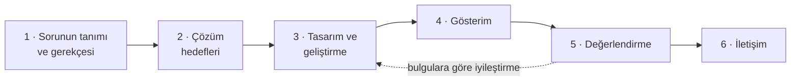

# Araştırma

[← README](../README.md)

## İçindekiler

- [Literatürdeki eksiklik](#literatürdeki-eksiklik)
- [Araştırma sorusu](#araştırma-sorusu)
- [Hipotezler](#hipotezler)
- [Amaç ve ölçülebilir hedefler](#amaç-ve-ölçülebilir-hedefler)
- [Araştırma tasarımı](#araştırma-tasarımı)
- [Değişkenler](#değişkenler)
- [Kullanılabilirlik deneyi](#kullanılabilirlik-deneyi)
- [Tutarlılık, eşzamanlılık ve güvenlik testleri](#tutarlılık-eşzamanlılık-ve-güvenlik-testleri)
- [Ulusal politika ve öncelikli alanlarla ilişki](#ulusal-politika-ve-öncelikli-alanlarla-ilişki)

## Literatürdeki eksiklik

- İncelenen mobil envanter çalışmaları karekodu her kalemi benzersiz biçimde etiketlemek için kullanmakta (Rizqi vd., 2018) ya da hane ve küçük ticari kullanıcılara yönelik karekod tabanlı stok takibi sunmaktadır (Voo vd., 2020). Ancak bu çalışmalar **reçeteye dayalı üretimi, kısmi mal kabulü, vadeli satış ve tahsilatı, kasa hareketlerini ve çevrim içi satışı** tek bir tutarlı işlem zincirinde ele almamaktadır.
- KOBİ'lerde ERP üzerine çalışmalar ise bulut ERP'nin benimsenme aşamalarını (Salim vd., 2015) ve ERP benimseme maliyetlerini (Haddara ve Elragal, 2013) konu edinmektedir.
- Mevcut envanter yazılımlarının çoğu büyük kuruluşların gereksinimlerine göre tasarlanmıştır; hane ve küçük ticari kullanıcılara uygun sistemler oldukça sınırlıdır (Voo vd., 2020).

SmartStock bu boşluğu, küçük üretim işletmelerine özgü, **mobil öncelikli ve çok kiracılı** bir mimari tasarlayıp **ölçülebilir ölçütlerle** değerlendirerek kapatmayı hedefler.

## Araştırma sorusu

> Küçük üretim işletmelerinde reçete tabanlı üretim, stok, satın alma, satış, cari, kasa ve isteğe bağlı pazaryeri süreçlerinin; veritabanı düzeyinde kiracı yalıtımı ve sunucu tarafı atomik işlemlerle çalışan çok kiracılı bir mobil ERP mimarisinde birleştirilmesi, bu güvenceleri kullanmayan karşılaştırma sürümlerine ve manuel veri girişine göre **veri tutarlılığını**, **yetkisiz erişime karşı korumayı** ve **işlem süresini** ne ölçüde iyileştirir ve **kabul edilebilir bir kullanılabilirlik** düzeyine ulaşır mı?

## Hipotezler

| | Hipotez |
|---|---|
| **H1 · Veri tutarlılığı** | Aynı eşzamanlı işlem senaryosunda, değerleri istemcide hesaplayıp tabloya yazan karşılaştırma sürümünde stok, cari ve kasa arasında mutabakat farkı ve eksi bakiye oluşurken; stok ve para değiştiren tüm işlemlerin satır kilitli atomik sunucu fonksiyonlarıyla yürütüldüğü önerilen mimaride **mutabakat farkı 0** olur ve stok ya da kasa eksiye düşmez. |
| **H2 · İşlem süresi** | Kamerayla kod okutma, aynı görevlerin listeden manuel seçimle yapılmasına göre ortalama görev tamamlama süresini istatistiksel olarak anlamlı biçimde (α = 0,05) ve **en az %30** kısaltır. |
| **H3 · Erişim güvenliği** | Arayüzü atlayıp doğrudan API'ye gönderilen isteklerde, yalnızca arayüzde düğme gizleyen karşılaştırma sürümü yetkisiz erişime izin verirken; arayüz filtreleme, RLS politikaları ve fonksiyon içi rol denetiminden oluşan üç katmanlı yetkilendirme başka şirketin verisine, rol dışı işlemlere ve rol dışı veri isteyen asistan sorularına yönelik **tanımlı senaryoların tamamını** engeller. |
| **H4 · Kullanılabilirlik** | Mobil uygulamanın ortalama SUS puanı, kabul edilebilir kullanılabilirlik eşiği olan **70**'e ulaşır ya da onu aşar. |

## Amaç ve ölçülebilir hedefler

**Amaç:** Küçük üretim işletmeleri için tedarik, reçete tabanlı üretim, karekod/barkod destekli depo yönetimi, satış, cari hesap ve kasa süreçlerini isteğe bağlı çok satıcılı bir pazaryeriyle birlikte tek bir tutarlı işlem zincirinde birleştiren, çok kiracılı, rol tabanlı ve YZ asistanı destekli bir mobil ERP sistemi geliştirmek ve etkinliğini deneysel olarak doğrulamak.

| # | Hedef | Başarı ölçütü |
|---|---|---|
| 1 | Çok kiracılı veri modeli ve güvenlik | Tüm iş tablolarında `company_id` ve RLS; tablo başına kiracı yalıtım testlerinin **%100**'ü geçer |
| 2 | Atomik iş kuralları | Her fonksiyon için başarılı işlem, yetkisiz rol ve yetersiz stok/bakiye testleri geçer; **≥ 200 işlemlik** karma senaryoda mutabakat farkı **0** |
| 3 | Mobil uygulama | Ön çalışmada doğrulanan **30'dan fazla** ekran .NET MAUI ve MVVM ile kodlanır; Android'de uçtan uca çalışır |
| 4 | Kod okuma | Normal ışıkta test etiketlerinin **≥ %95**'i ilk denemede okunur ve ilgili işlem penceresi açılır |
| 5 | Pazaryeri | Uçtan uca sipariş akışları çalışır; **20 eşzamanlı alıcıyla** stoktan fazla satış **0** |
| 6 | YZ asistanı | Üç rol için **≥ 60 soruluk** (rol başına ≥ 20) test setinde rol dışı veri sızıntısı **0**, yetkili sorularda doğru yanıt **≥ %90** |
| 7 | Değerlendirme | **≥ 20 katılımcı** ile H2 sınanır, ortalama SUS **≥ 70**; 20 eşzamanlı istemci altında 95. yüzdelik yanıt süresi **< 500 ms** |

## Araştırma tasarımı

Araştırma, belirlenmiş örgütsel sorunları çözmeye yönelik bilişim artefaktları oluşturmayı ve değerlendirmeyi amaçlayan **tasarım bilimi araştırması** paradigmasına dayanır (Hevner vd., 2004). Süreç, tasarım bilimi araştırma metodolojisinin altı adımını izler (Peffers vd., 2007):

| Adım | Bu projede |
|---|---|
| 1–2 · Sorun ve hedefler | Araştırma önerisinin 1. bölümü |
| 3 · Tasarım ve geliştirme | İP-1 – İP-5 (her iş paketi sonunda derlenen, test edilen ve sürüm kontrolüne kaydedilen artımlı adımlar) |
| 4 · Gösterim | İki örnek şirketle hazırlanan pilot veri seti ve en az bir işletmede pilot kullanım |
| 5 · Değerlendirme | İP-6 |
| 6 · İletişim | Bildiri ve teknik rapor |

## Değişkenler

| Tür | Değişken |
|---|---|
| **Bağımsız** | Kullanılabilirlik deneyinde veri giriş yöntemi (kamerayla kod okutma / listeden manuel seçim) ve görev türü |
| | Tutarlılık testlerinde işlem yürütme biçimi (atomik sunucu fonksiyonu / istemcide hesaplayıp yazan karşılaştırma sürümü) ve eşzamanlı istemci sayısı (1, 5, 20) |
| | Güvenlik testlerinde yetkilendirme biçimi (yalnızca arayüz / üç katman) ve kullanıcı rolü |
| **Bağımlı** | Görev tamamlama süresi (sn), görev başarısı (%) ve hata sayısı |
| | Stok–cari–kasa mutabakat farkı (adet / TL) |
| | Yetkisiz erişim engelleme oranı (%) |
| | Sunucu fonksiyonu yanıt süresi (ms; ortalama ve 95. yüzdelik) |
| | SUS puanı (0–100) |
| | Asistanın doğru yanıt ve rol dışı veri sızıntısı oranları (%) |

## Kullanılabilirlik deneyi

- **Tasarım:** Denek içi tasarım; en az **20 gönüllü** (bölüm öğrencileri ve küçük işletme çalışanları), örnek şirket verisi üzerinde, Yönetici rolüyle.
- **Görevler:** Kod okutularak başlatılabilen altı standart görev: malzeme stok sorgusu, ürün reçetesi görüntüleme, mal kabul, üretim, satış, sayım düzeltmesi. Her görev iki yöntemle yapılır.
- **Karşı dengeleme:** Öğrenme etkisini dengelemek için katılımcıların yarısı kamerayla, yarısı manuel yöntemle başlar.
- **Ölçüm:** Süreler uygulama içi zaman damgalarıyla kaydedilir.
- **Süre kazancı:**

$$
\text{Kazanç} = \frac{t_{\text{manuel}} - t_{\text{kamera}}}{t_{\text{manuel}}}
$$

- **İstatistik:** Fark puanlarının normalliği **Shapiro–Wilk** testiyle sınanır; normal dağılımda **eşleştirilmiş örneklem t-testi**, aksi hâlde **Wilcoxon işaretli sıralar testi** uygulanır (α = 0,05) ve etki büyüklüğü raporlanır.
- **Kullanılabilirlik:** On maddelik, 0–100 arası tek bir bileşik puan veren **SUS** ile ölçülür (Brooke, 1996). 70 ve üzeri puan geleneksel olarak "geçer" kabul edildiği için başarı ölçütü 70'tir (Bangor vd., 2009).
- **Etik:** Katılımcılardan kimlik bilgisi alınmaz, yanıtlar anonim tutulur; gerekirse etik kuruldan onay ya da muafiyet alınır.

## Tutarlılık, eşzamanlılık ve güvenlik testleri

| Test | Yöntem | Beklenen sonuç |
|---|---|---|
| **Mutabakat** | Her ürün ve malzeme için hareketler toplamı stok miktarına, her cari bakiye hareketler toplamına eşit mi? Kasa hiçbir anda eksiye düştü mü? | Fark **0**, eksi bakiye yok |
| **Eşzamanlılık** | 20 istemci aynı ürünü aynı anda satın almaya çalışır | Satılan miktar stoğu aşmaz |
| **Yetkisiz erişim kataloğu** | Her tablo ve rol için okuma/yazma denemeleri, arayüz atlanarak doğrudan API'ye | Tanımlı senaryoların **%100**'ü engellenir |
| **Performans** | Bulut ortamında 20 eşzamanlı istemci | 95. yüzdelik yanıt süresi **< 500 ms** |

**Karşılaştırma sürümleri:** Aynı senaryolar, kilit ve atomik işlem kullanmadan değerleri istemcide hesaplayıp yazan bir sürüme ve RLS'nin kapalı olduğu, yalnızca arayüzde gizleme yapan bir sürüme de uygulanarak farkın kaynağı gösterilir. Karşılaştırma sürümleri **yalnızca test ortamında** kurulur.

**Çalışma takvimiyle ilişki:** H1 ve H3'ün veritabanı bileşenleri İP-1 – İP-3 boyunca sürekli sınanır; pazaryeri eşzamanlılık testi İP-4'te, asistan test seti İP-5'te yapılır. Karşılaştırma sürümleriyle H1 ve H3'ün nihai sınaması, H2 ve H4 deneyleri ve performans ölçümleri İP-6'da gerçekleştirilir.

## Ulusal politika ve öncelikli alanlarla ilişki

- **On İkinci Kalkınma Planı (2024–2028):** Yapay zekâ gibi dijital teknolojilerin kullanımının rekabetçilik için kritik bir unsur hâline geldiği; veri yönetimi, dijital iş süreçleri ve otomasyon ile lojistik ve tedarik zinciri yönetiminde önemli bir dönüşüm yaşandığı belirtilmektedir (Strateji ve Bütçe Başkanlığı, 2023).
- **2030 Sanayi ve Teknoloji Stratejisi:** Bulut bilişimin stratejik öncelik olarak benimsenmesi, işletmelerin dijitalleşmesine yönelik teşviklerin genişletilmesi ve KOBİ'lerin e-ticaret ve lojistik platformlarına erişimi vurgulanmaktadır (Sanayi ve Teknoloji Bakanlığı, 2025).
- **TÜBİTAK öncelikli alanları:** "Yapay zekâ", "Büyük veri ve bulut bilişim" ve "Siber güvenlik" (TÜBİTAK, 2025).

---

[Yol haritası](yol-haritasi.md) · [Kaynakça](kaynakca.md)
