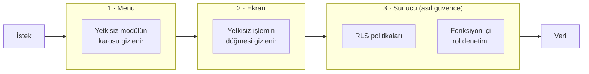
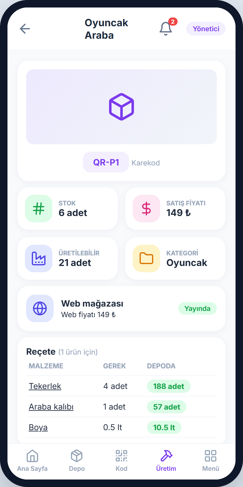
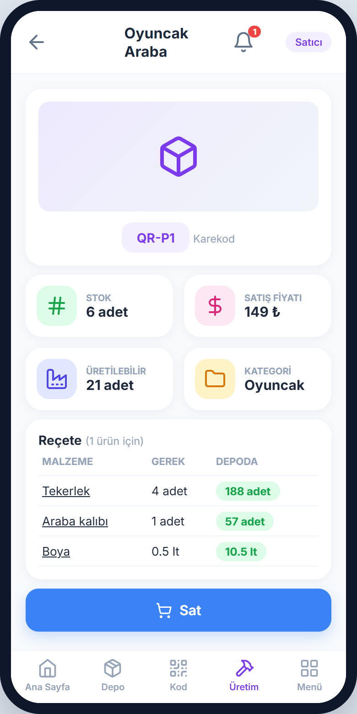
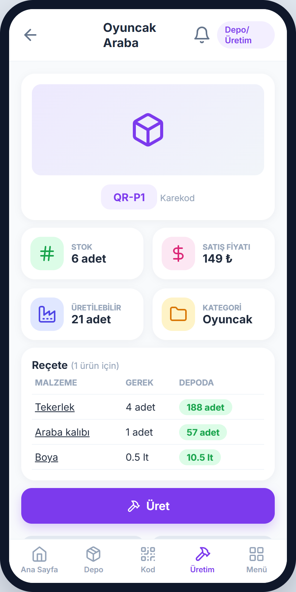
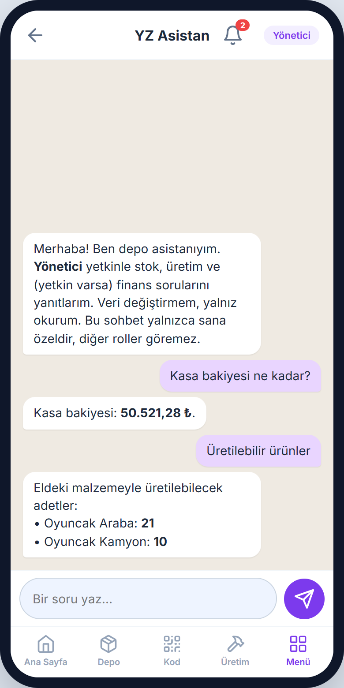
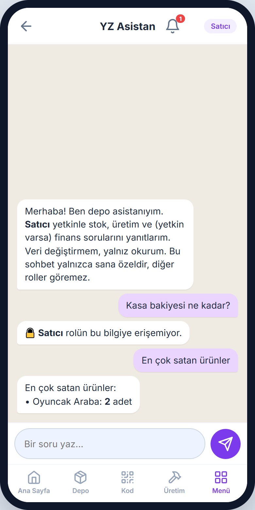

# Güvenlik ve roller

[← README](../README.md)

## İçindekiler

- [Üç katmanlı yetkilendirme](#üç-katmanlı-yetkilendirme)
- [Kiracı yalıtımı](#kiracı-yalıtımı)
- [Rol ve yetki matrisi](#rol-ve-yetki-matrisi)
- [Aynı ekran, farklı rol](#aynı-ekran-farklı-rol)
- [Ödeme güvenliği](#ödeme-güvenliği)
- [YZ asistanında en az yetki](#yz-asistanında-en-az-yetki)
- [Anahtar ve gizli bilgi yönetimi](#anahtar-ve-gizli-bilgi-yönetimi)
- [Kişisel veriler ve hesap kapatma](#kişisel-veriler-ve-hesap-kapatma)

## Üç katmanlı yetkilendirme

Yetkiler, kullanıcıların rollere ve izinlerin rollere atandığı **rol tabanlı erişim denetimi (RBAC)** modeline göre tanımlanır (Ferraiolo vd., 2001).

| Katman | Nerede? | Amaç |
|---|---|---|
| 1 · Menü | İstemci | Kullanıcı, yetkisi olmayan modülü hiç görmez |
| 2 · Ekran | İstemci | Görüntüleyebildiği ekranda yetkisiz düğmeler (iptal, fiyat değiştirme vb.) gösterilmez |
| 3 · Sunucu | PostgreSQL | Arayüz atlanıp doğrudan API'ye istek gönderilse bile RLS ve fonksiyon içi rol denetimi isteği reddeder |

Erişim denetimi yalnızca güvenilir sunucu tarafı kodunda uygulandığında etkilidir (OWASP, 2025a). Bu nedenle ilk iki katman **yalnızca kullanım kolaylığı** sağlar; güvenlik iddiası üçüncü katmana dayanır. Bu iddia, yalnızca arayüzde gizleme yapan bir karşılaştırma sürümüne karşı **H3** hipoteziyle sınanır (bkz. [Araştırma](arastirma.md)).

## Kiracı yalıtımı

Tüm kiracıların aynı veritabanını paylaştığı mimaride her kiracının yalnızca kendi verisine erişebilmesi zorunludur (Bezemer vd., 2010).

- Her iş tablosunda şirket kimliği (`company_id`) bulunur.
- PostgreSQL **satır düzeyi güvenlik (RLS)** politikaları uygulanır. RLS etkin bir tabloda her okuma ve yazma bir politikayla izin verilmiş olmalıdır; **politika yoksa hiçbir satır görünmez** (PostgreSQL Global Development Group, 2025b). Bu "varsayılan olarak kapalı" davranış, yeni eklenen bir tablonun yanlışlıkla açık kalmasını önler.
- Her tablo için **"başka şirketin üyesi okuyamaz ve yazamaz"** veritabanı testi yazılır; bu test yazılmadan iş paketi tamamlanmış sayılmaz.

## Rol ve yetki matrisi

| Modül | Yönetici | Satıcı | Depo/Üretim |
|---|---|---|---|
| Depo (malzeme) | Tam yetki | Yalnızca görüntüler | Tam yetki *(alış fiyatını görmez)* |
| Üretim (ürün, reçete) | Tam yetki; maliyet ve kâr/marj görür | Yalnızca görüntüler | Görüntüler ve üretim yapar |
| Tedarikçi | Tam yetki (IBAN dahil) | Erişim yok | Yalnızca görüntüler *(borç ve IBAN gizli)* |
| Satın alma ve mal kabul | Tam yetki (iptal dahil) | Erişim yok | Sipariş ve kısmi mal kabul |
| Müşteri ve satış | Tam yetki (fiyat değiştirir, iptal eder) | Satış yapar *(fiyat salt okunur)* | Erişim yok |
| Cari hesap | Tam yetki (ödeme/tahsilat, manuel kayıt) | Yalnızca alacakları görür | Erişim yok |
| Kasa, kullanıcılar, CSV, sıfırlama | Yalnızca Yönetici | Erişim yok | Erişim yok |
| Web Satış ve Web Siparişleri | Yalnızca Yönetici *(mağazası olan şirkette)* | Erişim yok | Erişim yok |
| İşlem kaydı | Tüm kayıtlar | Yalnızca kendi işlemleri | Yalnızca kendi işlemleri |
| YZ asistanı (salt okunur) | Tüm operasyonel ve finansal veri | Satış ve alacak tarafı | Stok ve üretim tarafı |

**Platform yöneticisi** şirket rollerinden ayrıdır: satıcı başvurularını onaylar, kategori komisyonlarını yönetir ve hakedişleri izler.

**Personel daveti:** Yönetici, seçtiği rol için tek kullanımlık ve süreli bir davet kodu üretir. Personel kayıt olurken kodu girince o rolle şirkete katılır. Şirketteki son aktif yönetici başka bir role alınamaz.

## Aynı ekran, farklı rol

Aynı ürün kartı üç rolde farklı davranır:

<table>
  <tr>
    <td align="center"> <b>Yönetici</b>: tüm bilgiler</td>
    <td align="center"> <b>Satıcı</b>: yalnızca <i>Sat</i> düğmesi</td>
    <td align="center"> <b>Depo/Üretim</b>: yalnızca <i>Üret</i> düğmesi</td>
  </tr>
</table>

Aynı soru, farklı rol: YZ asistanı satıcının kasa bakiyesi sorusunu reddeder, yöneticiye yanıt verir.

<table>
  <tr>
    <td align="center"> <b>Yönetici</b>: kasa bakiyesi yanıtlanır</td>
    <td align="center"> <b>Satıcı</b>: "rolün bu bilgiye erişemiyor"</td>
  </tr>
</table>

## Ödeme güvenliği

- Ödeme **yalnızca kartla**, ödeme kuruluşunun sayfasında alınır; kart bilgisi mağazanın sunucusuna **hiç ulaşmaz**.
- Ödeme işlemini tümüyle üçüncü tarafa devreden üye işyerleri için birçok PCI DSS gereksinimi doğrudan uygulanmayabilir; ancak kart verisinin üçüncü tarafça korunmasını sağlama sorumluluğu sürer (PCI Security Standards Council, 2026). Bu nedenle sistem **PCI DSS uyumlu, lisanslı** bir ödeme kuruluşuyla çalışır.
- Ödeme sonucu yalnızca **sunucu tarafında** doğrulanır; istemciden gelen "ödendi" bilgisine güvenilmez.
- Gerçek para hareketi proje kapsamı dışındadır; ödemeler ödeme kuruluşunun test ortamında sınanır.

## YZ asistanında en az yetki

Büyük dil modeli uygulamalarında beklenmeyen, belirsiz ya da manipüle edilmiş model çıktılarının zarar verici işlemlere yol açtığı **"aşırı yetki"** açığına karşı, model uzantılarının işlev ve izinlerini gereken en az düzeyle sınırlama ilkesi izlenir (OWASP, 2025b):

| Önlem | Uygulama |
|---|---|
| Yazma yetkisi yok | Asistan veri değiştiremez; modelin çağırabileceği araç yoktur |
| Rol süzgeci modelden önce | Özet, kullanıcının oturum kimliği ve rolüyle sunucuda üretilir; model rol dışı veriyi hiç görmez |
| Kişisel veri yok | TCKN, IBAN, telefon ve adres özete konmaz; kişiler kod numarasıyla temsil edilir |
| Sızıntı testi | Üç rol için en az 60 soruluk test setinde rol dışı veri sızıntısı **0** olmalıdır |
| B planı | Sızıntı testi başarısız olursa sızıntıya yol açan özet alanı kaldırılır; yine başarısız olursa asistan kural tabanlı modda sunulur |

## Anahtar ve gizli bilgi yönetimi

- Mobil uygulamada ve web sitesinde yalnızca **herkese açık (anon) anahtar** bulunur.
- Yönetici anahtarları ve dil modeli API anahtarı yalnızca sunucu ortamında tutulur ve **sürüm kontrolüne girmez**.
- Sızıntı şüphesinde anahtarlar yenilenir.

## Kişisel veriler ve hesap kapatma

- Kullanılabilirlik deneyinde katılımcılardan kimlik bilgisi alınmaz, yanıtlar anonim tutulur.
- İşlem kaydı olan bir personel silinmez: hesabı kapatılır, adı, e-postası ve telefonu silinerek "Eski personel" olarak anonimleştirilir; işlem kayıtları denetim için korunur.
- Pazaryerinde müşteri şifreleri tek yönlü özetlenerek saklanır; formlar CSRF anahtarıyla korunur; kullanıcı girdileri sayfaya kaçışlı (escape edilmiş) basılır.

---

[Mimari](mimari.md) · [Araştırma](arastirma.md) · [Kaynakça](kaynakca.md)
