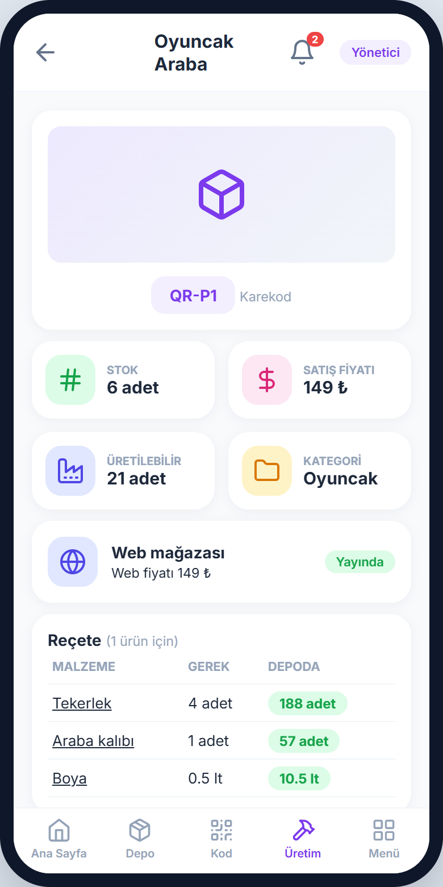
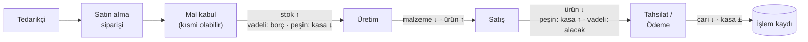
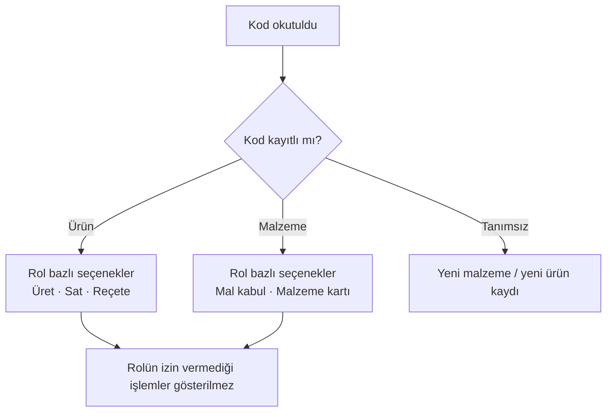
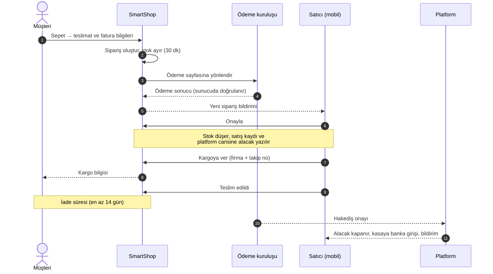
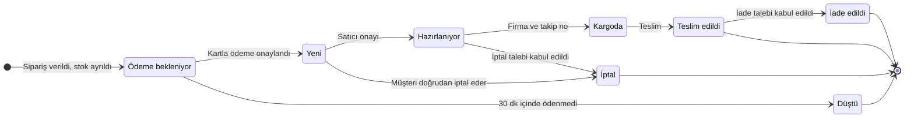

# İş akışları

[← README](../README.md)

## İçindekiler

- [Temel ilke: stok formdan değişmez](#temel-ilke-stok-formdan-değişmez)
- [Reçete tabanlı üretim](#reçete-tabanlı-üretim)
- [Depo ve ticari akış](#depo-ve-ticari-akış)
- [Kod okuma akışı](#kod-okuma-akışı)
- [Pazaryeri akışı](#pazaryeri-akışı)
- [Web siparişi durum makinesi](#web-siparişi-durum-makinesi)

## Temel ilke: stok formdan değişmez

Stok miktarı bir formdan elle değiştirilemez. Stok yalnızca aşağıdaki hareketlerle değişir ve **hiçbir hareket silinmez**; hatalar ters kayıtla düzeltilir.

| Hareket | Stok etkisi | Para etkisi |
|---|---|---|
| Mal kabul | Malzeme **+** | Vadeli: tedarikçi borcu · Peşin: kasa **−** |
| Üretim | Malzeme **−**, ürün **+** | — |
| Satış | Ürün **−** | Peşin: kasa **+** · Vadeli: müşteri alacağı |
| Ters kayıtla iptal | Orijinal hareketin tersi | Orijinal hareketin tersi |
| Gerekçeli sayım düzeltmesi | Fark kadar ± | — |
| Tahsilat / ödeme | — | Cari **−**, kasa **±** |

> [!IMPORTANT]
> Satın alma siparişi tek başına stok ya da borç **oluşturmaz**. Stok ve tedarikçi borcu **mal kabulde** oluşur ve **kısmi teslimat** desteklenir.

## Reçete tabanlı üretim

Her ürün, malzeme ve miktarlardan oluşan bir **reçeteyle** (Bill of Materials, BOM) tanımlanır. Parça taleplerinin nihai ürün talebine bağımlı olması, ekonomik sipariş miktarına dayanan klasik stok kontrol yöntemlerini yetersiz kılar (Aydoğan ve Asal, 2009). Reçete bu bağımlılığın yazılımdaki karşılığıdır.

Sistem üretilebilir azami miktarı anlık hesaplar:

$$
Q_{\max} = \min_{i = 1, \dots, n} \left\lfloor \frac{S_i}{r_i} \right\rfloor
$$

$S_i$: *i*. malzemenin stoğu · $r_i$: bir ürün için gereken miktar

<table>
  <tr>
    <td width="260"></td>
    <td>

**Örnek: Oyuncak Araba**

| Malzeme | $r_i$ | $S_i$ | $\lfloor S_i / r_i \rfloor$ |
|---|---|---|---|
| Tekerlek | 4 adet | 188 adet | 47 |
| Araba kalıbı | 1 adet | 57 adet | 57 |
| Boya | 0,5 lt | 10,5 lt | **21** |

$Q_{\max} = \min(47, 57, 21) = 21$ adet. Darboğaz boyadır.

Üretim onaylandığında malzemeleri düşen ve ürün stoğunu artıran işlem **tek bir veritabanı işleminde** gerçekleşir. Malzeme yetmezse üretim yapılmaz ve en fazla üretilebilecek adet gösterilir.

</td>
  </tr>
</table>

## Depo ve ticari akış

| Adım | Kurallar |
|---|---|
| **Tedarikçi** | IBAN doğrulamalı kayıt; geçmiş kaydı olan tedarikçi silinemez, pasife alınır |
| **Satın alma siparişi** | Beklenen teslim tarihi; geciken teslimatlar uyarılarda görünür |
| **Mal kabul** | Gelen miktar kadar stok artar; kısmi teslimat desteklenir; son alış fiyatı güncellenir |
| **Satış** | Peşin ya da vadeli; müşteri **kredi limiti** kontrol edilir; satıcı rolü fiyatı değiştiremez |
| **Cari hesap** | Vade sıralı borç/alacak listesi; geciken kayıtlar uyarı üretir |
| **Kasa** | Kasa **hiçbir anda eksiye düşmez**; gelir/gider kayıtları kategorilidir |
| **İşlem kaydı** | Her hareket kim, ne zaman, hangi yöntemle (manuel / kamera) bilgisiyle kaydedilir |

### Ana sayfa uyarıları

Uyarılar da rol yetkisine göre süzülür; kullanıcı yalnızca işlem yapabileceği konuların uyarısını görür.

| Uyarı | Tetikleyen durum | Gören roller |
|---|---|---|
| Kritik stok | Malzeme stoğu uyarı eşiğine indi | Yönetici, Depo/Üretim |
| Teslimat gecikti | Satın alma siparişinin beklenen teslim tarihi geçti | Yönetici, Depo/Üretim |
| Yaklaşan / gecikmiş borç | Tedarikçi borcunun vadesi yaklaştı ya da geçti | Yönetici |
| Yaklaşan / gecikmiş alacak | Müşteri alacağının vadesi yaklaştı ya da geçti | Yönetici, Satıcı |
| Yeni web siparişi, iptal/iade talebi | Pazaryerinden onay ya da yanıt bekleyen kayıt | Yönetici |

## Kod okuma akışı

Her malzeme ve ürün şirket içinde benzersiz bir **karekod ya da barkoda** sahiptir; etiketler uygulamadan üretilip yazdırılır. Etiketler, kısmen yıpranmış etiketlerin de okunabilmesi için karekodun yüksek hata düzeltme düzeyiyle üretilir (ISO/IEC, 2024).

Kamera bir **hızlandırıcıdır, zorunlu değildir**: tüm işlemler arama çubuğu ve ayrıntı ekranlarındaki düğmelerle manuel olarak da tamamlanabilir. Kamera ile manuel seçim arasındaki süre farkı H2 hipoteziyle ölçülür (bkz. [Araştırma](arastirma.md)).

## Pazaryeri akışı

- **Satıcı başına bölme:** Farklı satıcıların ürünlerini içeren sipariş satıcı başına parçalara bölünür; her satıcı yalnızca kendi parçasını görür.
- **Komisyon:** Kategori bazında platform tarafından belirlenir ve sipariş anında kaleme kopyalanır. Sonradan oran değişse bile geçmiş siparişler etkilenmez.
- **Cayma hakkı:** Tüketici 14 gün içinde gerekçe göstermeksizin cayma hakkına sahiptir ve satıcı iadeyi 14 gün içinde yapmakla yükümlüdür (Gümrük ve Ticaret Bakanlığı, 2014). Bu nedenle iade süresi en az 14 gündür.
- **Hakediş:** Hakedişin ödendiğine yalnızca ödeme kuruluşunun onayı karar verir.

## Web siparişi durum makinesi

| Durum | Müşteri ne yapabilir? | Satıcı ne yapabilir? |
|---|---|---|
| **Yeni** | Doğrudan iptal | Onayla (stok düşer) · iptal et |
| **Hazırlanıyor** | İptal **talebi** gönderir | Talebi kabul/ret · kargoya ver |
| **Kargoda** | — | Teslim edildi olarak işaretle |
| **Teslim edildi** | İade süresi içinde iade **talebi** | Talebi kabul (stoka geri ekle / ekleme) · gerekçeyle ret |

> [!NOTE]
> Açık bir iptal talebi varken sipariş **kargoya verilemez**. Satıcı talebi reddederse gerekçesini yazmak zorundadır ve müşteri bu gerekçeyi sipariş sayfasında görür.

---

[Mimari](mimari.md) · [Güvenlik ve roller](guvenlik-ve-roller.md) · [Ekran görüntüleri](ekran-goruntuleri.md)
