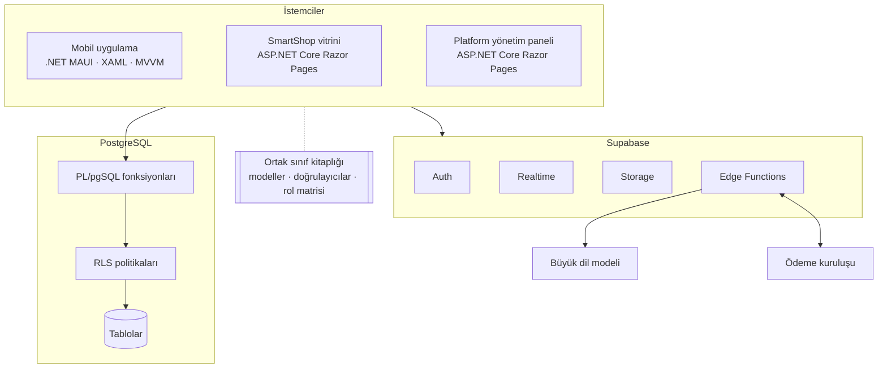
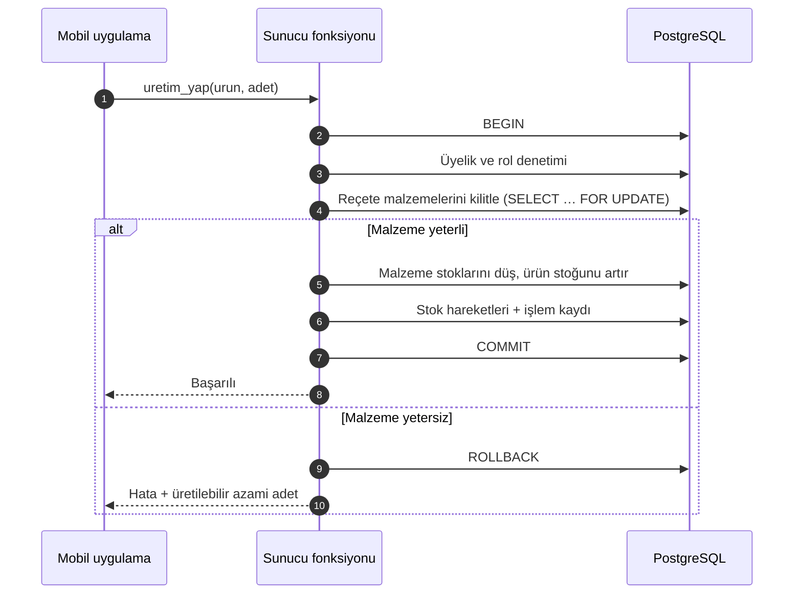
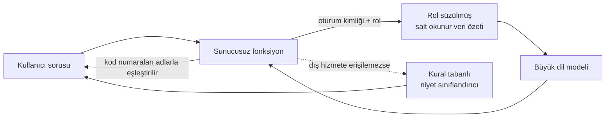

# Mimari

[← README](../README.md)

SmartStock üç istemciden (mobil uygulama, pazaryeri vitrini, platform yönetim paneli) ve tutarlılığın sunucuda sağlandığı çok kiracılı bir bulut arka ucundan oluşur. Bu doküman, araştırma önerisinde tanımlanan hedef mimariyi özetler.

## İçindekiler

- [Bileşenler](#bileşenler)
- [Mobil ve web istemcileri](#mobil-ve-web-istemcileri)
- [Arka uç ve veri modeli](#arka-uç-ve-veri-modeli)
- [Kimlik doğrulama](#kimlik-doğrulama)
- [Atomik işlemler ve eşzamanlılık](#atomik-işlemler-ve-eşzamanlılık)
- [Pazaryeri ve ödeme](#pazaryeri-ve-ödeme)
- [YZ asistanı](#yz-asistanı)
- [Test ve kalite güvencesi](#test-ve-kalite-güvencesi)
- [Mimari kararlar](#mimari-kararlar)

## Bileşenler

| Bileşen | Görev |
|---|---|
| **Mobil uygulama** | İşletme çalışanlarının günlük kullanımı: depo, üretim, kod okuma, satın alma, satış, cari, kasa, web siparişleri, YZ asistanı |
| **SmartShop vitrini** | Müşterinin gördüğü pazaryeri: katalog, ürün sayfası, satıcı bazlı sepet, ödeme, sipariş takibi, iptal/iade talepleri |
| **Platform yönetim paneli** | Satıcı başvurularının onayı, kategori komisyonları, hakediş izleme |
| **Ortak sınıf kitaplığı** | İki .NET uygulamasının paylaştığı modeller, doğrulayıcılar (TCKN/VKN/IBAN, para biçimi) ve rol matrisi |
| **Supabase** | PostgreSQL tabanlı açık kaynaklı arka uç: kimlik doğrulama, gerçek zamanlı bildirim, dosya depolama, sunucusuz fonksiyonlar |

## Mobil ve web istemcileri

- **.NET MAUI**, Android, iOS, macOS ve Windows için tek bir ortak kod tabanından C# ve XAML ile yerel uygulama geliştirmeye olanak verir (Microsoft, 2025). Proje **Android öncelikli** geliştirilecek, iOS derlemesi ikincil hedef olacaktır.
- **MVVM** deseni iş ve sunum mantığını arayüzden ayırır ve görünüm modellerinin görünüm olmadan birim testine olanak tanır (Microsoft, 2024). Ön çalışmadaki her ekran bir XAML sayfasına ve bir görünüm modeli (ViewModel) sınıfına karşılık gelecektir.
- **Pazaryeri vitrini ve platform paneli** ASP.NET Core Razor Pages ile geliştirilecektir.

## Arka uç ve veri modeli

Geliştirme yerel ortamda yapılır; şema yalnızca **sürümlenen geçiş (migration) dosyalarıyla** değiştirilir.

| Tablo grubu | İçerik |
|---|---|
| **Kiracılık** | şirketler, üyelikler ve roller, davetler |
| **Ana veri** | malzemeler, ürünler, reçete kalemleri, kategoriler, tedarikçiler, müşteriler |
| **Hareketler** | stok hareketleri, satın alma ve mal kabul, satış başlık ve satırları, cari ve kasa hareketleri, işlem kaydı |
| **Pazaryeri** | satıcı başvuruları, mağazalar, komisyon oranlı web kategorileri, siparişler, satıcı başına sipariş parçaları, sipariş kalemleri, talepler, hakedişler, e-posta kuyruğu |

- Her iş tablosunda şirket kimliği (`company_id`) bulunur ve **RLS** etkindir.
- Para değerleri ondalık (`numeric`) tipte, zaman damgaları **UTC** olarak tutulur.
- Belge numaraları şirket başına sayaçlardan üretilir.

## Kimlik doğrulama

- **E-posta/şifre** ve **Google hesabı** ile giriş.
- Yetkilendirme kodu akışını kullanan genel istemciler kodun ele geçirilmesi saldırısına açık olduğundan **PKCE** uzantısı kullanılır (Sakimura vd., 2015).
- Yerel uygulamalarda yetkilendirme istekleri yalnızca kullanıcının tarayıcısı gibi **harici bir kullanıcı aracısı** üzerinden yapılır (Denniss ve Bradley, 2017); tarayıcıdan uygulamaya dönüş derin bağlantıyla sağlanır.
- Şirketi olmayan kullanıcı, **şirket kurma** ya da **davet koduyla katılma** ekranına yönlendirilir. Bir kullanıcı birden fazla şirkete üye olabilir ve etkin şirketi seçer.

## Atomik işlemler ve eşzamanlılık

İstemci stok ve para tablolarına **doğrudan yazamaz**. Tüm değişiklikler PL/pgSQL ile yazılan sunucu fonksiyonlarıyla yapılır:

Fonksiyon adı açıklama amaçlıdır.

- Bir veritabanı işlemi birden çok adımı tek bir **"ya hep ya hiç"** işlemi olarak toplar; tamamlanamayan işlemin hiçbir adımı veritabanını etkilemez ve ara durumlar eşzamanlı diğer işlemlere görünmez (PostgreSQL Global Development Group, 2025a).
- `stok ≥ 0` ve `kasa ≥ 0` kısıtları; çakışmada işlem geri alınır ve kullanıcıya anlaşılır bir hata gösterilir.
- İptal ve düzeltmeler **ters kayıtla** yapılır; hiçbir hareket silinmez.

## Pazaryeri ve ödeme

- Mağaza açmak isteyen şirket başvurur, platform yöneticisi onaylayınca ürünlerini yayınlar.
- Web stoğu depo stoğuyla **ortaktır**. Sipariş verildiğinde stok ayrılır; 30 dakika içinde ödenmeyen sipariş düşer.
- Farklı satıcıların ürünlerini içeren sipariş **satıcı başına parçalara** bölünür; her satıcı yalnızca kendi parçasını görür.
- Ödeme **yalnızca kartla**, ödeme kuruluşunun sayfasında alınır. Sistem kart verisini hiçbir aşamada almaz; yalnızca ödeme sonucunu sunucu tarafında doğrular (PCI Security Standards Council, 2026).
- Ödeme katmanı bir arayüzle soyutlanır: önce bir **demo sağlayıcıyla**, ardından lisanslı bir ödeme kuruluşunun pazaryeri test ortamında sınanır.
- Komisyon kategori bazında platform tarafından belirlenir ve sipariş anında kaleme kopyalanır. Hakediş ödeme kuruluşunun onayıyla kapanır, kasaya banka girişi yazılır ve satıcının mobil uygulamasına gerçek zamanlı bildirim gider.

Akışın tamamı ve durum makinesi için: [İş akışları](is-akislari.md).

## YZ asistanı

- Fonksiyon, kullanıcının oturum kimliği ve rolüyle **yalnızca yetkili olduğu veriden** salt okunur bir özet üretir; modele yalnızca bu özet ve soru verilir.
- Modelin çağırabileceği **araç ya da yazma yetkisi yoktur**. Bu, büyük dil modeli uygulamalarındaki "aşırı yetki" açığına karşı önerilen en az yetki ilkesine dayanır (OWASP, 2025b).
- Özete TCKN, IBAN, telefon ve adres gibi kişisel veriler konmaz; müşteri ve tedarikçiler kod numarasıyla temsil edilir, yanıt uygulamada adlarla eşleştirilir.
- Özette olmayan bilgi istendiğinde asistan bunu açıkça belirtir. Bu, metin üretim modellerinin halüsinasyon eğilimine karşı alınan bir önlemdir (Ji vd., 2023).
- API anahtarı yalnızca sunucu ortamında tutulur.

## Test ve kalite güvencesi

| Katman | Araç | Zorunlu testler |
|---|---|---|
| Veritabanı | **pgTAP** | Her tablo için kiracı yalıtım testi ("başka şirketin üyesi okuyamaz ve yazamaz"); her fonksiyon için başarılı işlem, yetkisiz rol ve yetersiz stok/bakiye testleri |
| Paylaşılan iş kuralları | **xUnit** | Para biçimi, TCKN/VKN/IBAN doğrulama, rol matrisi |
| Bütünleşik | Karşılaştırma sürümleri | Mutabakat sorgusu, eşzamanlılık ve yetkisiz erişim kataloğu (bkz. [Araştırma](arastirma.md)) |

Testleri geçmeyen bir iş paketi **tamamlanmış sayılmaz**.

## Mimari kararlar

| Karar | Gerekçe |
|---|---|
| Çevrim dışı öncelikli yerel veritabanı yerine **bulut + sunucu tarafı tutarlılık** | Ön çalışmada çok kullanıcılı eşzamanlı kullanımda stok ve kasa tutarlılığının cihazlar arasında güvence altına alınamayacağı görüldü. |
| Şirket başına ayrı veritabanı yerine **paylaşılan şema + RLS** | Çok kiracılı mimari, birden fazla müşterinin aynı uygulama ve veritabanı örneğini paylaşmasıyla ölçek ekonomisi sağlar (Bezemer vd., 2010); RLS etkin bir tabloda politika yoksa hiçbir satır görünmez (PostgreSQL Global Development Group, 2025b). |
| Yetkiyi arayüzde değil **sunucuda** denetlemek | Erişim denetimi yalnızca güvenilir sunucu tarafı kodunda uygulandığında etkilidir (OWASP, 2025a). |
| Stok ve para değişikliklerini **tek fonksiyon çağrısında** toplamak | İstemcide hesaplayıp yazmak yarış durumlarına ve mutabakat farkına yol açar (H1). |
| Uygulamada yalnızca **herkese açık (anon) anahtar** | Yönetici anahtarları yalnızca sunucu ortamında tutulur ve sürüm kontrolüne girmez. |

---

[Kaynakça](kaynakca.md) · [Güvenlik ve roller](guvenlik-ve-roller.md) · [İş akışları](is-akislari.md)
